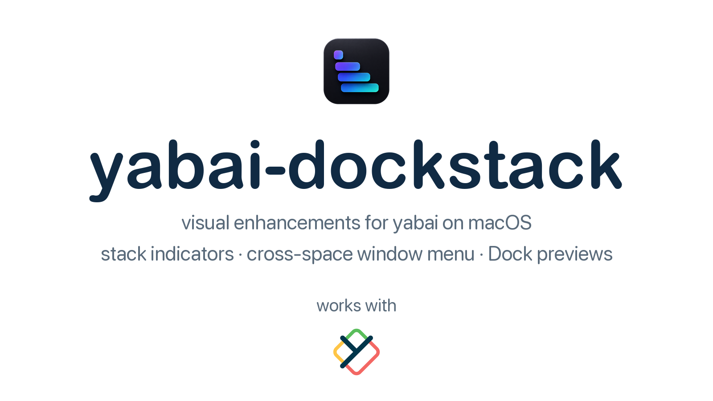
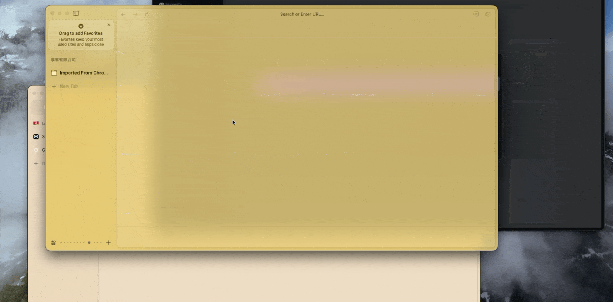
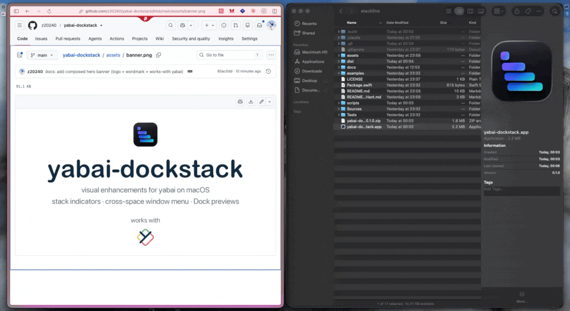
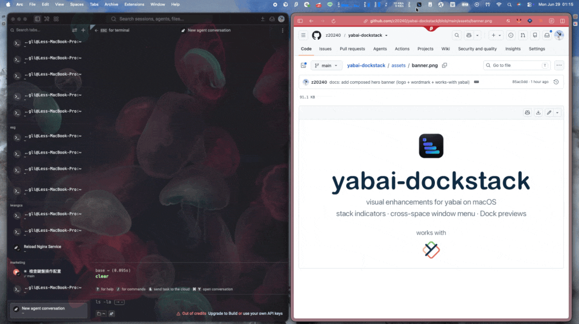
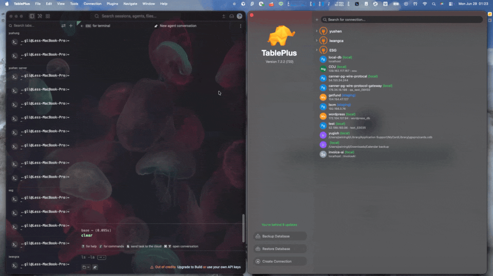
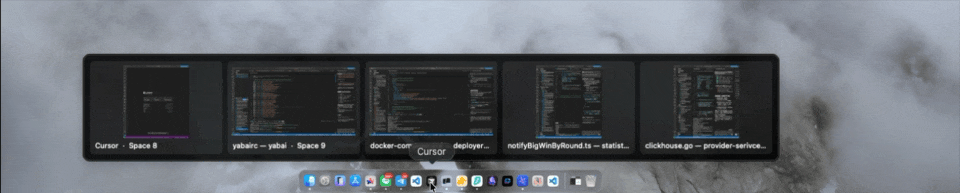

<div align="center">



[](https://github.com/z20240/yabai-dockstack/releases)
[](https://github.com/z20240/yabai-dockstack/stargazers)
[](LICENSE)


[English](README.md) · 繁體中文

<sub>靈感來自 [stackline](https://github.com/AdamWagner/stackline)、DockView 與 AltTab ·
關鍵字:yabai、stackline、dockview、alt-tab、macOS 視窗管理、tiling、stack 指示器、
dock 預覽、視窗切換器、cmd-tab 替代、選單列、Mission Control 替代</sub>

</div>

---

`yabai-dockstack` 幫 yabai 補上它缺的視覺層:

- **Stack 指示器** —— 在每個視窗 stack 旁顯示浮動指示器,讓你一眼看出哪些 app 疊在一起、順序為何(靈感來自 **stackline**)。
- **跨 space 視窗選單** —— 選單列依 Display → Space 列出所有視窗;點一下就跳轉並聚焦。
- **Dock 視窗預覽** —— 滑鼠移到 Dock 圖示,偏看該 app 跨所有 space 的視窗縮圖;點一下跳轉(靈感來自 **DockView**)。
- **AltTab 風格視窗切換器** —— 按住 ⌥ 輕點 Tab:跨所有 space、**每個視窗一格縮圖**
  (不是每個 app 一個圖示),依最近使用排序;放開 ⌥ 即切換。五個編輯器視窗終於分得出來
  —— 這正是 ⌘⇥ 做不到的事(靈感來自 **AltTab**)。

這是用 Swift 重寫的乾淨版本,**不是** stackline 的 fork(stackline 需要 Hammerspoon)。

## 最新變更 — v0.4.1

- **Tray 型 app 回到 switcher** —— 關到 tray 再叫回來的視窗(LINE、dockstack 自己的設定視窗)
  在 v0.4.0 會整個消失,因為 yabai 弄丟了它們的 AX reference。現在 switcher、Spaces View、
  window strip、選單和 Dock preview 都會再顯示它們,點擊也能正確 focus。
- 真的關到 tray 的視窗(Surfshark、Gather 主視窗)一樣不顯示。

完整紀錄:[CHANGELOG.md](CHANGELOG.md) ·
[Releases](https://github.com/z20240/yabai-dockstack/releases)

## Demo

**視窗切換器** —— 所有 space 的所有視窗,一個按鍵直達。



**Stack 指示器** —— 一眼看出哪些 app 疊在一起、在哪裡。



**跨 space 視窗選單** —— 所有視窗依 Display → Space 分組,點一下跳轉。



**跨 space 跳轉聚焦** —— 一鍵跳到該視窗所在的 space。



**Dock 視窗預覽** —— 滑鼠移到 Dock 圖示偏看該 app 的視窗,點一下跳轉。



**依專案顯示標籤** —— 每個 VS Code 視窗都顯示自己的專案名稱。


**視窗列** —— 選單列下方顯示每個螢幕的視窗與所在 space。


**按住 ⌃ 拖曳調整 stack 順序** —— 直接在指示器上操作。


**搜尋式切換器** —— 用你設定的「搜尋式切換器」熱鍵打開(Settings → Switcher):每個 space
顯示成一張迷你桌面,依顯示器分組。


**打字篩選** —— 不符合的視窗會在原位變淡。


**拖曳視窗到其他 space** —— 即使它不在目前的 space。SIP 開著時會跳過去再走回來(如圖);
有 yabai scripting addition 時瞬間完成——見 [@Signynt 的示範](#拖曳視窗到其他-space)。


**也可以從視窗列拖** —— 把 chip 拖到另一個 space。


**Hyper Key** —— 把 Caps Lock(或右側修飾鍵)變成 ⌃⌥⌘⇧。


**自動調整 yabai 的 padding** —— Settings → Appearance;指示器和視窗列有自己的空間,不再壓到 App。


## 需求

- macOS 14+
- **[yabai](https://github.com/koekeishiya/yabai) —— 必要。** yabai-dockstack 是 yabai 的
  輔助工具,沒有 yabai 就**完全無法運作**:所有功能都靠 `yabai -m query` 取得視窗/stack
  狀態。沒有 yabai 時選單列只會顯示 **「yabai: not found」**。yabai 必須**安裝、執行中、
  且設定到能建立 stack**(請參考 yabai 的安裝/設定說明)。

## 安裝

### Homebrew(推薦)

```sh
brew install --cask z20240/tap/yabai-dockstack
```

Universal(Apple Silicon + Intel)。app 是 ad-hoc 簽章但**沒有經過 Apple notarize**,
原本會被 Gatekeeper 擋——cask 會在安裝後(postflight)移除 quarantine,所以不會跳警告。
若你是手動下載 release zip,請執行一次:
`xattr -dr com.apple.quarantine /Applications/yabai-dockstack.app`(或系統設定 →
隱私權與安全性 → **仍要打開**)。

**yabai 是必要的,但不會自動安裝**(它在第三方 tap,cask 無法自動 tap)。請自行安裝並啟動:

```sh
brew tap koekeishiya/formulae
brew install yabai
yabai --start-service          # 完整設定(含 SIP)見 yabai 官方文件
open -a yabai-dockstack
```

若啟動時找不到 yabai,app 會跳出**設定導引**(用 Terminal 安裝 yabai · 開啟安裝說明 ·
設定 yabai 路徑),選單列也會出現紅色 **「yabai not found — set up…」**。yabai 一旦
啟動,功能會自動開始運作。

### 從原始碼建置

```sh
./scripts/bundle.sh        # 產生 yabai-dockstack.app
open yabai-dockstack.app
```

> 若 `swift build` 抱怨 Xcode 授權,執行 `sudo xcodebuild -license accept`,或改用
> Command Line Tools:`DEVELOPER_DIR=/Library/Developer/CommandLineTools ./scripts/bundle.sh`。

### 首次啟動

除非你允許,dockstack 不會修改你的 `yabairc` 或 `skhdrc`。設定 → yabai 有
**允許 dockstack 編輯 yabairc**,設定 → 鍵盤有 **允許 dockstack 編輯 skhdrc**,
預設都是關閉。(如果你的 rc 檔已經有 dockstack 管理的區段,升級時對應的選項會自動打開一次。)

選項**關閉**時,分頁是唯讀的,並忠實呈現實際設定:yabai 分頁顯示 yabai 當下實際在跑的值,
跟檔案不同的地方標 `!`(滑鼠移上去看說明),yabai 沒在跑時改顯示檔案內容;鍵盤分頁顯示
`skhdrc` 裡真正的快捷鍵,其他快捷鍵收在「Other shortcuts」裡。要修改請自己編輯檔案
(**Open in editor**),**Reload** 會重新讀取。設定檔欄位顯示目前使用的 rc 檔,依 yabai / skhd
自己的尋找順序自動偵測(也會看 `-c`);**Choose…** 可以改選其他檔案,**Reset to auto** 回到自動偵測。

選項**打開**時,可以在設定裡編輯。**Apply** 在註解掉它接手管理的手寫行之前會先確認
(行首加上 `# [yabai-dockstack imported]`,只註解、不刪除,原檔保留為 `.bak`),再寫入管理區段。
有縮排的行(`if` 區塊或函式裡)一律不註解。啟動時不會寫任何檔案。關閉選項後就不會再寫入,
但已經寫入的管理區段會持續生效,直到你手動刪除。按住循環的切換器快捷鍵(存在 dockstack
自己的設定裡)和自動 padding 不受這兩個選項影響。例外是切換器分頁的**搜尋切換器**快捷鍵:
它是 skhd 的綁定,會寫進 `skhdrc`(跟 Apply 一樣會先確認),需要打開**允許 dockstack 編輯 skhdrc**。

啟動後 app 會:

- **自動偵測** yabai 位置(Homebrew Apple Silicon / Intel / nix,再 `which`);
- **自動註冊** 它需要的 yabai signal(指向自己),你完全不用改 `~/.yabairc`。

選單列會顯示 **yabai: connected ✓**,並列出所有視窗(依 Display → Space 分組,
有命名的 space 顯示自訂名稱)。它還提供:

- **Settings…** —— 調整外觀(icon/旗標)、大小、透明度、顏色、底板、滿版靠邊、
  計時(ms)、**yabai 路徑**(留空 = 自動偵測)、**開機自啟**。即時生效並儲存。
- **Re-register yabai signals** —— yabai 重啟後重新註冊 signal。

> 第一次開啟未簽章的 app,macOS 會擋一次:對 app 按右鍵 →「打開」,或執行
> `xattr -dr com.apple.quarantine yabai-dockstack.app`。用 Homebrew cask 安裝則會
> 自動移除 quarantine,不會跳警告。

## 視窗切換器(AltTab 風格)

macOS 的 ⌘⇥ 一個 app 只給一個圖示,五個編輯器視窗根本分不出來。這個切換器**每個視窗
一格**、涵蓋**所有 space**、依最近使用排序:

| 按鍵 | 動作 |
|---|---|
| 按住 **⌥** + 輕點 **Tab** | 循環**所有 space 的所有視窗**(⇧ 反向) |
| 按住 **⌥** + 輕點 **`** | 只循環**目前 App** 的視窗 |
| 方向鍵 / **W** 或 ✕ / **Esc** / **Enter** | 移動選擇 / 關閉視窗 / 取消 / 確認 |
| **⌘W** / **⌘Q** | 關閉選中視窗 / 結束該視窗的整個 App |
| 放開 **⌥** | 切換到選中的視窗(透過 yabai 跨 space 跳轉) |

- **兩種模式。**「按住循環」(上表)手感等同原生 ⌘⇥;「黏性模式」面板會停留,
  並支援**打字搜尋**(比對 app 名稱+視窗標題)—— 在 **Settings → Keyboard** 綁定
  「Open window switcher」即可。
- **三種外觀** —— 縮圖(預設)、app 圖示、精簡標題列表,視窗越多格子自動縮小
  (AltTab 式 auto-sizing)。在 **Settings → Switcher** 設定,含各範圍的快速鍵。
- **取代 ⌘⇥**(選用,預設關閉):直接攔截系統的 app 切換器;yabai 沒在跑時會自動把
  ⌘⇥ 還給 macOS。
- **縮圖**規則與 Dock 預覽相同:可見視窗即時擷取、其他 space 的視窗用最後快取
  (macOS 無法擷取隱藏 space),否則退回 app 圖示。
- **權限**:按住循環使用全域 event tap → 需要 **Accessibility**;黏性模式經由
  選單/skhd 開啟,除了 yabai 本身不需任何權限。

## Dock 視窗預覽

滑鼠移到 **Dock 的 app 圖示**,會彈出該 app 跨所有 space 的視窗;點一下就跳到那個
space 並聚焦。

- **縮圖**:目前可見 space 的視窗顯示即時縮圖;其他 space 的視窗 macOS 無法即時擷取
  (ScreenCaptureKit 會回 `-3811`),所以顯示**快取的最後一次縮圖**,沒有就退回
  **app 圖示 + 標題**。都可點擊。
- **權限**:需要 **Accessibility**(偵測 Dock hover)+ **Screen Recording**(擷取縮圖)。
  打開 **Settings → Permissions**:會顯示每個權限的即時狀態(✓ / ✗),並各有一個
  **Grant…** 按鈕——按下會請求該權限並直接開到對應的系統設定頁面,一次一個,
  避免兩個 prompt 互相蓋掉。授權 Accessibility 後功能會自動啟用(不用重開)。
  缺權限時此功能靜默不啟用;核心的 stack 指示器則完全不需要權限。
- **直接關閉視窗**:hover 縮圖會出現 **✕**,點一下即透過 yabai 關閉該視窗,
  預覽面板原地更新。關到該 app 的**最後一個**視窗時會直接結束整個 App——
  像 Music 這種關窗只是隱藏的 app 也能真正關掉。
- **開關**:Settings →「Dock window previews」(預設開啟)。

## 視窗列與滑鼠停留選單

兩者預設關閉,在 **Settings → Appearance** 開啟。

- **視窗列**:每個螢幕一條,就在選單列正下方。列出**該螢幕**(所有 space)上的每個
  視窗:圖示+標籤(編輯器顯示專案名稱),space 之間以分隔線隔開;目前的 space 有底色、
  聚焦中的視窗有外框。滑鼠停在 chip 上顯示完整標題與 space,點一下跳轉。視窗太多時
  標籤先縮短、再只剩圖示,最後出現 **+N**(點了打開視窗選單)。在 Settings 拖曳
  **視窗列大小** 即可調整尺寸。把 **chip 拖到** 另一個 space 的區段即可移動視窗(拖曳時空的
  space 會展開成放置區)。原生全螢幕 space 會自動隱藏;可能會蓋住視窗頂端——
  可勾選 Settings → Appearance 的 **自動調整 yabai 的 padding**,或自行調高 yabai 的 `top_padding`。
- **自動調整 padding**(選用,預設關閉):app 執行時把 yabai 的 `left_padding` / `right_padding`
  設成圖標大小 + 2,視窗列開著時把 `top_padding` 設成視窗列高度 + 6,讓兩者都不會蓋到 App。
  會跟著圖標大小和視窗列大小變化(圖標變小 padding 也變小),只用 `yabai -m config` 套用,
  不改 yabairc;取消勾選或結束 app 時還原你原本的值。三欄以上排列時,夾在中間的 stack
  圖標仍可能壓到隔壁視窗(`window_gap` 不會調整)。
- **滑鼠停留展開**:游標停在選單列圖示上 ¼ 秒就展開視窗選單。選單也有快捷鍵
  (Settings → Keyboard →「Open window menu」)。

## 拖曳視窗到其他 space

Mission Control 只能把**目前** space 的視窗拖走。打開**搜尋式切換器**(Settings → Switcher
→「搜尋式切換器」熱鍵):每個 space 顯示成一張迷你桌面,依顯示器分組,裡面排著它的視窗
(來自 @Signynt 的 Spaces View,#4)。每個視窗有一個膠囊標籤,顯示 App 圖示和專案名稱;
目前所在的 space 標示 **目前**。直接打字篩選,不符合的視窗會變淡。方向鍵 / Enter / 點擊
focus 視窗;點卡片的空白處會跳到那個 space。

- **拖曳視窗**到另一個 space 就移過去,也能拖進你目前所在的 space。在視窗列拖曳 chip 也一樣。
  - 有 yabai scripting addition:瞬間移動,切換器保持開著,可以連續移好幾個視窗。在
    Settings → Switcher 打開 **拖到其他 space 後跟著視窗過去** 則會跟著跳過去。
  - SIP 開著:切換器會關閉,app 先 focus 該視窗(跳到它的 space),再用和「移到 space」
    快捷鍵相同的模擬手勢帶過去——你會看到它移動的過程——最後停在目標 space。縮到系統匣
    的視窗無法用這種方式移動。
- **拖曳整個 space** 到另一個 space 會交換兩邊的視窗。**需要 scripting addition**;SIP
  開著時拖曳 space 沒有作用。
- 有 scripting addition 時,移動和交換的樣子(影片由 @Signynt 錄製,來自 #4):

https://github.com/user-attachments/assets/2ed311f6-c563-4742-a8aa-2d875b0b4ad8

- 可選擇在卡片後面顯示桌布(Settings → Switcher,可分別指定淺色和深色圖片)。

## Hyper Key

選用,**預設關閉**(Settings → **Hyper Key**)。按住指定的鍵等同同時按住 ⌃⌥⌘⇧,
可以綁很多不衝突的快捷鍵(skhd 寫法:`hyper - h`)。

- **按鍵**:無 / Caps Lock / 右 ⌘ / 右 ⌥ / 右 ⌃。
- **單按**(只按它):無動作 / Escape / 切換大寫鎖定(僅 Caps Lock)。
- **包含 Shift**:關閉時只有 ⌃⌥⌘(skhd 寫成 `ctrl + alt + cmd - h`)。
- **以 ✦ 顯示 ⌃⌥⌘⇧**(快捷鍵編輯器中)。
- 需要 **Accessibility**。使用 `hidutil`(app 執行期間該鍵會變成 F18;你其他的
  `hidutil` 對映會保留,我們的對映在結束時、或當機後下次啟動時移除)。
- 若 Raycast 或 Karabiner 已提供 Hyper Key,請勿同時開啟。密碼欄位(Secure Input)中無效。

## 安裝到 Homebrew(發佈者)

1. 用 `scripts/release.sh` 建 universal `.app` 並打包 zip,發一個 GitHub Release。
2. 開一個 `homebrew-tap` repo,把 `dist/yabai-dockstack.rb` 放進 `Casks/`(填入 sha256)。
3. 使用者:`brew install --cask <帳號>/tap/yabai-dockstack`。

## 安全嗎?(簽章與權限)

yabai-dockstack 是開源(MIT)且免費的,**刻意不做付費的 Apple Developer ID 簽章與
notarize**——那要 $99/年,而這是社群專案、不是付費產品。對你的影響:

- **第一次開啟 Gatekeeper 會擋。** 開啟方式:對 app 右鍵 →「**打開**」,或系統設定 →
  隱私權與安全性 →「**仍要打開**」,或
  `xattr -dr com.apple.quarantine /Applications/yabai-dockstack.app`。用 Homebrew cask
  安裝會自動移除 quarantine,直接就能開。
- **不想信任預編的二進位?** 自己 build:`./scripts/bundle.sh`。整個 app 就幾百行 Swift,
  可以從頭讀到尾。
- **無網路、無分析、不回傳。** 只會呼叫你本機的 `yabai`,以及(預覽時)在本機擷取視窗。

**權限——每個功能只要它需要的:**

| 功能 | 權限 |
|---|---|
| Stack 指示器 + 跨 space 視窗選單 | **不需要**(只用 `yabai -m query` / `--focus`) |
| Dock 視窗預覽 | **Accessibility**(偵測 hover 的 Dock 圖示)+ **Screen Recording**(視窗縮圖) |
| 視窗切換器 —— 按住循環 / ⌘⇥ 攔截 | **Accessibility**(全域快速鍵 event tap);縮圖沿用 **Screen Recording** |

不用 Dock 預覽的話可以完全不授權。權限只在啟用該功能時才請求,沒給也不影響其他功能。

## 授權

MIT。
